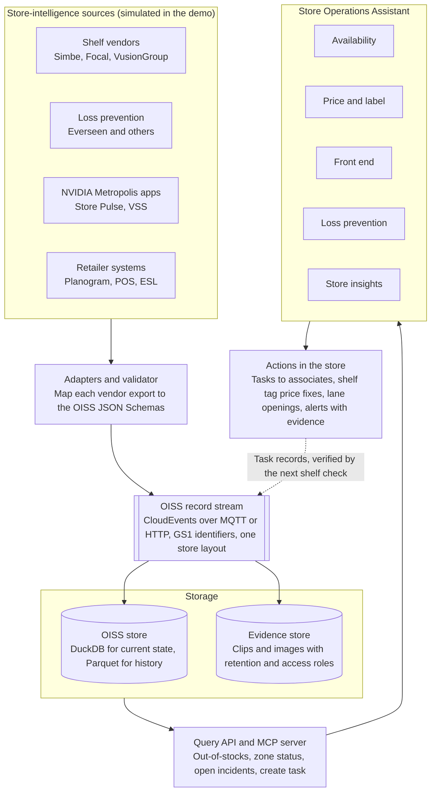

# OISS: Open Intelligent Store Specification

OISS is a draft open interchange standard for store-intelligence data. Its goal is to let a retailer combine data from several vendors with complementary services, such as shelf scanning, shopper analytics and loss prevention, with its own in-house systems, and use the result to run its stores better.

Each source publishes what it saw as OISS records, so any consumer, from a store operations dashboard to an AI agent, reads one record set for the whole store. OISS also includes a blueprint for using that data with agent platforms: a reference app where agents read OISS records and raise store tasks, so the value shows right away.

> **Status:** v0.1 draft, milestone M3 in progress (vendor feeds and adapters; loss prevention is in). Nothing here is stable yet. The goal is a live web demo of a synthetic grocery store running on OISS records, with agents that act on them.

## Why a retailer would adopt it

- **One view across vendors.** On-shelf availability from a shelf-scanning robot, traffic and queue data from a people-counting system, and exceptions from loss-prevention vision line up on one store layout and one item master, so they can be joined. Today each sits in its own vendor dashboard.
- **Use cases no single vendor covers.** Replenish the out-of-stocks with the most shopper traffic first, close a task only when the next shelf scan shows it fixed, and tie a front-end exception to the missing high-shrink item.
- **No lock-in.** Change or add vendors without rewiring every downstream report, task tool or agent.
- **Agent-ready.** A query API and an MCP server let any agent platform read the data and write tasks back, with every answer traceable to its source and model.

## What adoption takes

- **No rip and replace.** Vendors keep their own systems. An adapter maps each vendor's existing export to OISS, usually one small service per feed.
- **Start with one record type.** A store layout plus shelf observations is enough for on-shelf availability; traffic, front-end and loss-prevention data can follow.
- **Existing identifiers.** Items are keyed by GTIN (the UPC or EAN already in the item master) and stores by the retailer's own store number, with an optional GS1 GLN.
- **Existing standards underneath.** A CloudEvents envelope, GS1 identifiers and ONVIF-compatible object classes, so integration teams work with tools they already know.
- **Privacy built in.** No faces or biometrics, aggregates by default, and a privacy class, retention date and access roles on every record that needs them.

## Architecture



Data moves top to bottom, in five layers:

1. **Sources.** Each vendor and in-house system keeps doing what it does today: shelf-scanning robots and cameras report on-shelf availability and price integrity, people-counting systems report traffic and queues, loss-prevention vision reports front-end exceptions, and retailer systems supply the planogram, item master and prices. In the demo all of these are simulated.
2. **Adapters and validator.** One small adapter per vendor feed maps that vendor's export to OISS records, and `oiss-validate` checks each record against the schemas before it is published. A vendor that emits OISS natively needs no adapter.
3. **Record stream.** Every record is a CloudEvents event with GS1 identifiers and a location on one store layout, so records from different vendors about the same facing, zone or lane line up without custom joins.
4. **Storage.** Current state (what is on each shelf now, each zone's latest traffic and queue) sits in DuckDB, history in Parquet. Clips and images go to a separate evidence store that enforces each item's retention date and access roles.
5. **Query API, MCP server and agents.** Any dashboard, task system or agent platform reads OISS through the query API or the MCP server. The reference Store Operations Assistant routes each question to one of five agents, and their actions reach the store as tasks to associates, shelf tag price fixes, lane openings and alerts with evidence for a person to review. A task is written back as a Task record and closes only when the next ShelfObservation shows the fix.

## Key features

- **Store Operations Assistant.** A reference orchestrator that routes each question to one of five agents, each reading OISS through MCP:
  - **Availability agent:** prioritizes replenishment by lost sales, and closes a task only when the next shelf check shows it fixed.
  - **Price and label agent:** fixes wrong shelf prices through the electronic shelf label or a task.
  - **Front-end agent:** opens a lane when a queue grows, and feeds queue trends to labor scheduling.
  - **Loss prevention agent:** ties a front-end exception to an anonymous shopper path, a missing item and the evidence, for a person to review.
  - **Store insights agent:** measures display lift, compares stores and flags where two vendors disagree about the same shelf.
- **Seven record types.** A small shared core, versioned as v0.1 and listed below.
- **Adapters and validation.** One adapter per vendor export, a schema validator, and a mapping from ShelfObservation to a GS1 EPCIS 2.0 ObjectEvent.
- **Storage and query.** DuckDB for current state, Parquet for history, and an evidence store that enforces retention.
- **Agent access.** An MCP server with tools such as out-of-stocks since a time, zone status, open incidents and create task.
- **Access control.** Each record's privacy class limits what a reader sees, and guardrails check agent actions before they reach a store system.
- **Traceability.** Every record carries its source system, model and version, a confidence and links to evidence, so every agent answer can cite where it came from.

Today the spec, schemas, examples, validator, store simulator, the demo replay with its record inspector, and a browsable spec are built; the rest arrives milestone by milestone, as the table under [What's here](#whats-here) shows.

## Record types

| Record | What it says |
| --- | --- |
| StoreLayout | Zones, fixtures, shelves and facings, with the planogram and camera placement |
| ShelfObservation | On-shelf availability, planogram compliance and price integrity at one facing |
| ZoneMetric | Traffic, dwell, queue length, wait time and open lanes for one zone over one interval |
| ShopperPath | An anonymous shopper path on the floor plan; off by default |
| Incident | A loss-prevention exception or safety incident, with a confidence, for a person to review |
| Evidence | A clip or image reference with time range, camera, retention and access roles |
| Task | A store task, such as replenish or fix a shelf tag, and its status |

## What's here

| Folder | Contents | Milestone |
| --- | --- | --- |
| [`spec`](spec) | The specification text: envelope, store layout model, record types, vocabularies, identifiers, versioning | M0–M1 |
| [`schemas/v0.1`](schemas/v0.1) | JSON Schemas (draft 2020-12) for the envelope and the seven record types | M0 |
| [`examples`](examples) | One valid and one invalid record per type | M0 |
| [`validator`](validator) | `oiss-validate`, a Python validator for vendors and integration teams | M0 |
| [`sim`](sim) | Synthetic grocery store simulator that writes a day of OISS records from a seed | M1 |
| [`web`](web) | The site: the OISS landing page at `/`, the demo store replay at `/demo/` and the spec browser at `/spec/` | M1–M2 |
| [`adapters`](adapters) | Mock vendor exports and adapters into OISS | M3 |
| [`server`](server) | Ingest, storage and the query API | M3–M4 |
| [`mcp`](mcp) | MCP server and the Store Operations Assistant | M4 |
| [`docs`](docs) | Demo decisions, the Netlify deployment guide and other notes | ongoing |

## Run the demo

Needs Node 22.18 or later.

```sh
npm install
npm run dev             # the site at http://localhost:5173, the demo store at /demo/, the spec at /spec/
npm test                # simulator tests
npm run golden:check    # the golden day still matches its manifest
```

The site deploys to Netlify from this repository with the settings in [`netlify.toml`](netlify.toml). See [docs/deploy-netlify.md](docs/deploy-netlify.md) to link it.

## Validate records

```sh
python3 -m venv .venv && . .venv/bin/activate
pip install -e "validator[test]"
oiss-validate examples/valid      # all pass
oiss-validate examples/invalid    # all fail, each for one stated reason
pytest validator/tests
```

## License

The specification text in [`spec`](spec) is under [CC BY 4.0](spec/LICENSE.md). Schemas, examples and code are under the [Apache License 2.0](LICENSE).
