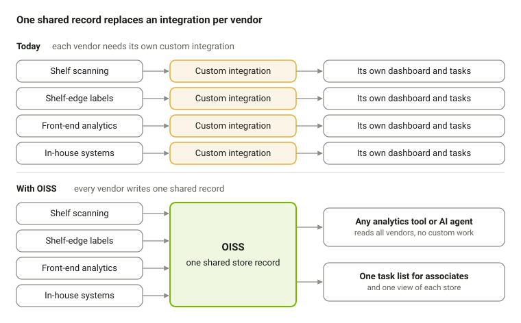
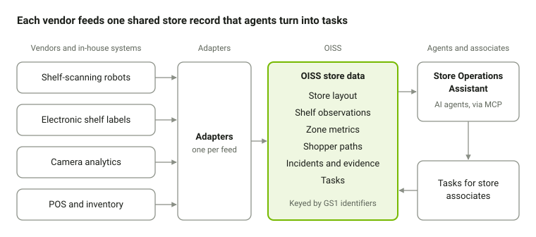

# OISS RFC: The case for an open store data standard

Bryan Yong · November 2026

The store-intelligence systems retailers need already exist, but they aren't compatible out of the box.

Vendors keep their own systems either way. OISS changes how their data is described, so any tool or AI agent can read all of it without custom work.

## Status of this document

| Item | Detail |
| --- | --- |
| Status | Draft for comment, version 0.1 |
| Comment period | Open until January 15, 2027 |
| Decision | The OISS editors revise the proposal after the comment period, then hand it to a neutral steward (section 9) |
| Related | The OISS specification, which holds the technical detail |

This draft is for retail and consumer goods (CPG) leaders, store-intelligence vendors, and standards bodies to test against the stores and systems they run. What they find missing shapes OISS before any organization adopts it as a standard.

## Summary

Retailers now buy store intelligence from several vendors at once: shelf-scanning robots, shelf cameras, electronic shelf labels, and front-end and loss-prevention analytics. Each vendor reports what it sees in its own format, so retailers pay to stitch the data together, store teams work from several task lists, and no analytics tool or AI agent can read across vendors without a custom integration. No open standard covers this layer today.

This RFC proposes the Open Intelligent Store Specification (OISS): an open, vendor-neutral format for what store-intelligence systems observe and the work they create, built on standards the industry already uses. It comes with a reference blueprint that shows AI agents acting on OISS data to fix empty shelves, wrong prices, and long checkout lines.

The questions for readers are whether the problem matches their experience, whether the proposed scope is right, and who should steward the standard.

## 1. The problem

Store intelligence is now bought from several vendors, but the data they produce can't be combined without custom work. A typical grocer might run:

- **Shelf scanning:** robots or fixed cameras that check on-shelf availability, planogram compliance, and price accuracy.
- **Shelf-edge systems:** electronic shelf labels and the platform that manages them.
- **Front-end and loss prevention:** analytics that watch checkout lines, self-checkout exceptions, and shrink.
- **In-house systems:** the item master, perpetual inventory, replenishment, and associate task management.

Each vendor ships its own API, dashboard, and field names. The same empty facing can arrive as three different records with three different product codes, locations, and confidence scores. To use them together, the retailer's IT team, or a systems integrator it pays, builds and maintains a custom integration layer, one vendor at a time.

The integration layer is only part of the cost:

1. **Integration cost and lock-in:** every new vendor, and every change of vendor, means new integration work. Retailers end up locked in, slow to add or switch vendors even when a better one appears.
2. **Store execution:** associates receive tasks from several systems that don't know about each other, and no one has a single view of on-shelf availability, price accuracy, or shrink for a store.
3. **Blocked automation:** analytics and AI agents can only act on data they can read, so each agent built on store data has to repeat the integration work before it can do anything.

CPG brands feel the same gap from the other side. On-shelf availability, planogram compliance, and promotion execution at retail are their numbers too, but each retailer and each vendor reports them differently, if at all.

## 2. What exists today, and why it falls short

Open standards already cover the layers below store intelligence, but none covers store intelligence itself. Each solves a narrower problem, and OISS would build on them. The table reflects each standard as of November 2026.

| Standard | What it does, in plain terms | What it leaves out |
| --- | --- | --- |
| [GS1 identifiers](https://www.gs1.org/standards-overview) | Give every product (GTIN, the number behind the UPC or EAN barcode) and every location (GLN) a global ID | What is happening on the shelf right now |
| [GS1 EPCIS and CBV](https://www.gs1.org/epcis) | Record supply-chain events (what, when, where, why), such as an item stocked or received; version 2.0 from June 2022 | Shelf facings, price-label checks, checkout lines, store tasks, and video evidence |
| [ONVIF Profile M](https://www.onvif.org/profiles/profile-m/) | Lets security cameras report people, vehicles, and object counts in a common format | Anything about shelves, products, or store operations |
| [OMG retail standards](https://www.omg.org/spec/category/retail/) (formerly ARTS at NRF) | Cover POS devices, digital receipts, and a 2019 video-analytics schema | Shelves, inventory, and store tasks; no sign the video schema was adopted |
| [Bluetooth ESL](https://www.bluetooth.com/blog/bluetooth-esl-the-global-standard-for-the-electronic-shelf-label-market/) | Standardizes the radio link between access points and electronic shelf labels | The price data and compliance checks behind the label |
| [CloudEvents](https://www.cncf.io/announcements/2024/01/25/cloud-native-computing-foundation-announces-the-graduation-of-cloudevents/) | A common envelope for event data across cloud systems | Anything retail |
| [Universal Commerce Protocol](https://www.shopify.com/ucp) | Lets AI agents shop online: discovery, checkout, and orders | Physical store operations |

Retail-specific efforts have not filled the gap either. The [Open Retail Reference Architecture](https://lf-edgexfoundry.atlassian.net/wiki/spaces/FA/pages/11675186/Open+Retail+Reference+Architecture), an edge platform effort by several large technology companies, defined no data model and has held no regular meetings since January 2023. A major cloud provider's [common data model for store operations](https://learn.microsoft.com/en-us/common-data-model/schema/core/industrycommon/retail/storeoperationsassistcommon/overview) defines store task entities but no shelf or sensor data. GS1 has no global planogram standard; GS1 Canada and GS1 Sweden run national services that supply product images and dimensions to space-planning tools.

Each vendor documents its own API, and none of them names an open format.

What is missing is a shared way to say "facing 14 on aisle 7 is empty, with this confidence, seen by this vendor at this time, and here is the evidence", and a shared way to turn that into a store task and confirm the task was done.

## 3. Why now

AI agents are starting to work in store operations, and each one needs cross-vendor data that no standard provides yet.

- **Agents are reaching the store:** at NRF 2026, [several large enterprise software providers announced MCP servers](https://erp.today/retail-ai-hits-nrf-2026-sap-microsoft-workday-turn-agentic-platforms-into-new-operating-system-for-stores-and-commerce/) for their commerce platforms. In October 2025 an electronic shelf label vendor said it would [open its in-store platform to AI agents](https://retailtimes.co.uk/vusiongroup-unveils-edgesense-ai-bringing-generative-intelligence-into-physical-eetail). MCP (Model Context Protocol) is an open protocol that a growing number of AI agents use to connect to business systems. An agent can only act across vendors if they share one format.
- **Online commerce already has an open standard:** the [Universal Commerce Protocol](https://www.shopify.com/ucp), co-developed by large commerce and technology companies and backed by large retailers, gives agents one way to shop online. Store operations have nothing equivalent.
- **Openness has focused on models:** a [January 2026 industry report on AI in retail and CPG](https://siliconangle.com/2026/01/21/nvidia-report-finds-ai-set-take-off-retail-openness-required-scale/) centers on open AI models and choice of cloud, and names no open standard for the data those models produce in stores.
- **Integration debt is still small:** each retailer that wires its vendors and agents together privately adds one more custom layer to maintain, and a shared format agreed early costs far less than many private ones reconciled later.

## 4. The proposal

OISS, the Open Intelligent Store Specification, is an open, shared format for the operational data that a store's technology produces. It sits beside each vendor's product and defines how that product's output is described, so a retailer can combine those outputs with its own systems and put AI agents to work on the result.

*Diagram: vendor feeds go through adapters into shared OISS store data, which AI agents turn into tasks for store associates.*

Each vendor keeps its own system. A small adapter turns its feed into OISS records, AI agents read those records, and the tasks they raise come back as records too, so every action can be traced.

### One map of the store

Every record points to a place in a single store model: store, department or zone, fixture (an aisle, endcap, or case), shelf, and facing. These are the terms planogram and space-planning teams already use. Products are identified by GTIN and locations by GLN, the GS1 identifiers that retailers and suppliers already exchange.

### Seven kinds of record

| Record | What it says | Typical source |
| --- | --- | --- |
| Store layout | The fixtures, shelves, and planned facings in each zone | Space planning and planogram systems |
| Shelf observation | What was seen at a facing: in stock, out of stock, wrong price, misplaced product | Shelf-scanning robots, fixed cameras, electronic shelf labels |
| Zone metric | A measure for an area over time, such as queue length, traffic, or dwell | Front-end and traffic analytics |
| Shopper path | Anonymous movement through the store, with no identity attached | Camera or sensor analytics |
| Incident | Something that needs attention, such as a suspected loss event or a missed scan at checkout | Loss-prevention and checkout vision |
| Evidence | The image, clip, or reading behind an observation or incident, with its retention rule | Any vision vendor |
| Task | Work assigned to associates to fix an issue, and its outcome | Task management systems and AI agents |

### Adapters

A vendor, the retailer, or the community can write the adapter for a feed, and once written it serves every retailer that uses that vendor. Where an existing standard already fits, OISS uses it: shelf observations map to GS1 EPCIS events, camera metadata follows ONVIF, and records travel in the CloudEvents envelope.

### Room to grow without breaking stores

A standard that stores depend on has to change without forcing every vendor to upgrade on the same day. OISS is built for a store whose data comes from systems on different versions at once.

- **Every record names its version:** a store can hold records from a vendor on the newest version beside records from one that hasn't upgraded, and each is checked by its own version's rules.
- **Upgrades only add, until a major version:** a minor version adds fields and values; a system built for the last one keeps working by ignoring what it doesn't know. Changes that would break a system wait for a major version, with notice and a migration note.
- **Unknowns stay private:** a system that meets a privacy level or record type it doesn't recognize treats it as restricted, so a newer version never makes an older system show more than it should.
- **A place for vendor data:** a vendor can send data OISS doesn't define yet, labelled as its own, instead of keeping a side channel. Data that several vendors send is a candidate for the shared core. The ban on personal and biometric data applies there too.
- **A register of feeds:** each connected system states which records and versions it sends and reads, so an IT team can see when every vendor has moved and an old version can be retired.

### A blueprint for agents

OISS includes a reference design for a Store Operations Assistant: a set of AI agents, each focused on one area of store operations, that read OISS records through MCP and propose tasks, which a manager approves before they reach the store.

- **Availability:** finds out-of-stocks and gaps and sends replenishment tasks.
- **Price and label:** catches mismatches between shelf labels and the price file.
- **Front-end:** watches checkout lines and suggests when to open more registers.
- **Loss prevention:** groups related incidents and their evidence for review.
- **Store insights:** answers a manager's questions across all sources, flags where two sources disagree about the same shelf, and compares the store with others in its district.

The agents read OISS records and never process raw video. Each answer and task cites the records behind it, so a manager can check it before acting.

An early reference demonstration is at [open-intelligent-store.netlify.app](https://open-intelligent-store.netlify.app/): a simulated grocery store fed by four representative vendors and the retailer's own systems, with three more stores in its district for comparison. The OISS specification holds the technical detail.

### What OISS does not do

- It does not change how any vendor detects or measures; it only describes the results.
- It does not require a particular camera, robot, cloud, or agent platform.
- It does not set store policy, such as replenishment rules or staffing levels; those stay with each retailer.
- It does not move data anywhere the retailer has not chosen to send it.

## 5. Benefits

### For retailers

- **Lower integration cost:** each vendor connects once to a shared format instead of to every other system in the store.
- **Freedom to choose vendors:** a vendor can be added, replaced, or run side by side with another without rebuilding integrations.
- **One view of the shelf:** findings from robots, cameras, and shelf labels about the same facing come together. Where sources disagree, the disagreement shows up in one place instead of in separate dashboards.
- **Agents that work across vendors:** one assistant can act on every source, and each answer and task traces back to the records behind it.
- **Faster store execution:** issues become tasks for associates and their outcomes are recorded, so the retailer can measure time to fix as well as time to detect.

### For CPG brands

- **Comparable data across retail partners:** on-shelf availability, price accuracy, and placement are described in the same terms and keyed to the same GTINs, where retailers choose to share them.
- **Better retail execution and promotion compliance:** brands and retailers can agree on what a gap or a missed promotion means and act on the same facts.

### For technology vendors

- **One integration, many retailers:** an adapter built once serves every retailer that uses OISS.
- **Competing on capability:** smaller and specialized vendors can compete on what they detect instead of on how many custom integrations they can staff.
- **Ready for retailers' agents:** OISS output works with any agent platform the retailer chooses, and retailers are starting to make that a buying criterion.
- **A larger market:** an open ecosystem without lock-in lowers the cost of entry, so more specialized vendors can start up and plug in.

## 6. What adoption takes

OISS is designed to be adopted in steps, alongside the systems a retailer already runs.

1. **No rip and replace:** vendors keep their products and data pipelines, and adapters sit beside them.
2. **Start with one use case:** a retailer can begin with out-of-stock detection from one vendor's shelf observations, and add sources as the value shows.
3. **Identifiers already in place:** OISS uses GTIN and GLN, which retailers and suppliers already maintain, plus the store layout that space planning already holds.
4. **Test before going live:** sample data and a validator let a vendor or retailer test an adapter before it reaches a store.
5. **Agents when ready:** the records are useful to existing dashboards and task systems before any AI agent is introduced.

What each party does:

- **Retailers:** map their store layout into the model, pick a first use case, and ask vendors for OISS output.
- **Vendors:** publish or support an adapter for their feed.
- **CPG brands:** agree with retail partners on which records to share and on shared definitions.

## 7. Alternatives considered

| Alternative | Why it falls short |
| --- | --- |
| Do nothing: integrate vendor by vendor | Cost grows with every vendor and every agent, and each retailer pays it separately. Lock-in deepens as integrations pile up. |
| One vendor's platform for everything | Simplest to start, but no single vendor leads in every capability, and the retailer's store data ends up in one company's format. |
| Each retailer defines its own canonical schema | Works inside one retailer, but vendors face a different schema at every customer, and CPG brands get data they cannot compare across partners. |
| Extend GS1 EPCIS alone | EPCIS is the right home for product events and OISS maps to it, but it has no place for zone metrics, shopper paths, incidents with evidence, or the store layout they refer to. |
| Wait for a standards body to start one | The closest precedent, the OMG ARTS video analytics standard from 2019, has not been updated since. A working proposal that a standards body can adopt is the faster path. |

## 8. Privacy, security and responsible use

Store intelligence involves cameras, shoppers, and associates, so OISS builds privacy and security into the format itself. It proposes these principles:

- **No identity by default:** records describe shelves, zones, and events, and identify no one. Shopper paths are anonymous and carry no face, name, or loyalty ID.
- **Evidence under control:** images and clips stay with the retailer or its vendor. Records point to them without copying them, and carry their retention period and access rules.
- **People decide:** agents can flag a suspected loss event and gather its evidence, but a person reviews it before anyone is approached or accused.
- **Associates are not scored by stealth:** task records measure how quickly store issues are fixed. They are not a way to score individual associates without their knowledge.
- **The retailer controls sharing:** nothing flows to a vendor, a brand, or an agent platform unless the retailer chooses to share it.
- **Security and provenance:** every record names its source and time, so systems can authenticate feeds and agents can show where each fact came from.

Local law, such as privacy and biometric rules, still governs each deployment. OISS is meant to make compliance with it easier to show.

## 9. Governance, license, and open questions

The plan is for a neutral industry body to govern OISS.

- **License:** the specification is licensed under Creative Commons Attribution 4.0 (CC BY 4.0) and the reference code under Apache 2.0, so anyone can implement it without fees.
- **Stewardship:** OISS would move to a neutral steward once there is interest. Candidates include the OMG Retail community (home of the ARTS standards), GS1, or a Linux Foundation project.

### Open questions

1. Which organization should steward OISS, and on what timeline?
2. Which first use cases matter most to retailers and brands: availability, price accuracy, front-end service, or loss prevention?
3. How much of a store's layout should be shared with vendors, and how should it be protected?
4. Should shelf observations travel as native EPCIS events, or as OISS records with a published EPCIS mapping?
5. How should conformance be tested and recognized, so retailers can trust a vendor's claim of OISS support?

### Request for comment

Comments are welcome from retailers, CPG brands, technology vendors, and standards bodies, and from beyond technology teams: store operations, merchandising, loss prevention, and privacy and legal. The most useful comments name a real use case, a gap in the record types, or an existing standard OISS should adopt.

- **How to comment:** open an issue in the [OISS repository on GitHub](https://github.com/bcyong/oiss/issues).
- **When:** the comment period is open until January 15, 2027.
- **How comments are used:** the editors weigh every comment, but comments are not counted as votes.

### How this RFC moves forward

1. **Draft:** this version goes first to a small group of early reviewers.
2. **Comment:** the comment period described above.
3. **Revise and decide:** the editors publish a revised draft with a summary of the comments and how each was resolved. Until a steward is chosen, the editors make the decisions, and there is no vote.
4. **Hand off:** once a neutral steward adopts OISS, its process governs further changes.
5. **Archive:** this RFC and its comments stay on file as the record of why OISS exists. Later design changes go into the OISS specification, and this RFC stays as it is.

## Glossary

| Term | Plain meaning |
| --- | --- |
| Adapter | A small piece of software that translates one vendor's output into OISS records |
| AI agent | Software that reads data, reasons about it, and takes or proposes an action, such as raising a task |
| CBV | Core Business Vocabulary: GS1's standard list of business steps and product states used with EPCIS |
| CloudEvents | An open, vendor-neutral envelope for describing an event that one system sends to another, stewarded by the Cloud Native Computing Foundation |
| CPG | Consumer packaged goods: the brands and manufacturers whose products retailers sell |
| EPCIS | Electronic Product Code Information Services: GS1's standard for recording what happened to a product, where, and when |
| ESL | Electronic shelf label: a digital price label on the shelf edge |
| Facing | One product position on a shelf, as planned in the planogram |
| Fixture | A unit of store furniture that holds product, such as a gondola, endcap, or case |
| GLN | Global Location Number: GS1's identifier for a place, such as a store or a location within it |
| GTIN | Global Trade Item Number: the GS1 product number behind a barcode |
| MCP | Model Context Protocol: an open way for AI agents to connect to business systems and data |
| OMG ARTS | The Object Management Group's retail standards, including point-of-sale device and video analytics standards |
| ONVIF Profile M | A security-camera industry standard for how cameras describe what their analytics detect |
| Planogram | The plan that shows where each product goes on each fixture |
| UCP | Universal Commerce Protocol: an open standard for AI agents shopping online |

## References

1. GS1, [EPCIS and CBV standards](https://www.gs1.org/epcis); [CBV 2.0](https://ref.gs1.org/standards/cbv).
2. GS1, [Standards overview](https://www.gs1.org/standards-overview).
3. ONVIF, [Profile M](https://www.onvif.org/profiles/profile-m/).
4. Object Management Group, [Retail specifications](https://www.omg.org/spec/category/retail/) and [Video Analytics 1.0](https://www.omg.org/spec/VIDEOANALYTICS/).
5. Bluetooth SIG, [Bluetooth ESL: the global standard for the electronic shelf label market](https://www.bluetooth.com/blog/bluetooth-esl-the-global-standard-for-the-electronic-shelf-label-market/).
6. Cloud Native Computing Foundation, [CloudEvents graduation announcement](https://www.cncf.io/announcements/2024/01/25/cloud-native-computing-foundation-announces-the-graduation-of-cloudevents/), January 2024.
7. Universal Commerce Protocol, [project overview](https://www.shopify.com/ucp) and [technical overview](https://developers.googleblog.com/under-the-hood-universal-commerce-protocol-ucp/).
8. [Common Data Model: Store Operations Assist](https://learn.microsoft.com/en-us/common-data-model/schema/core/industrycommon/retail/storeoperationsassistcommon/overview).
9. [Open Retail Reference Architecture (ORRA)](https://github.com/edgexfoundry-holding/orra).
10. GS1 Canada, [Planogram content](https://www.gs1ca.org/planogram-content/); GS1 Sweden, [Validoo Planogram](https://gs1.se/en/standards-and-services/validoo-planogram/).
11. A store task-management vendor's [public API overview](https://www.zebra.com/content/dam/zebra_dam/en/presentation/customer-facing/zebra-devcon2023-presentation-customer-facing-reflexis-apis-robin-west-en-us.pdf), 2023.
12. ERP Today, [Retail AI hits NRF 2026](https://erp.today/retail-ai-hits-nrf-2026-sap-microsoft-workday-turn-agentic-platforms-into-new-operating-system-for-stores-and-commerce/).
13. Retail Times, [electronic shelf label vendor opens its in-store platform to AI agents](https://retailtimes.co.uk/vusiongroup-unveils-edgesense-ai-bringing-generative-intelligence-into-physical-eetail), October 2025.
14. SiliconANGLE, [industry report finds AI set to take off in retail, openness required to scale](https://siliconangle.com/2026/01/21/nvidia-report-finds-ai-set-take-off-retail-openness-required-scale/), January 2026.
